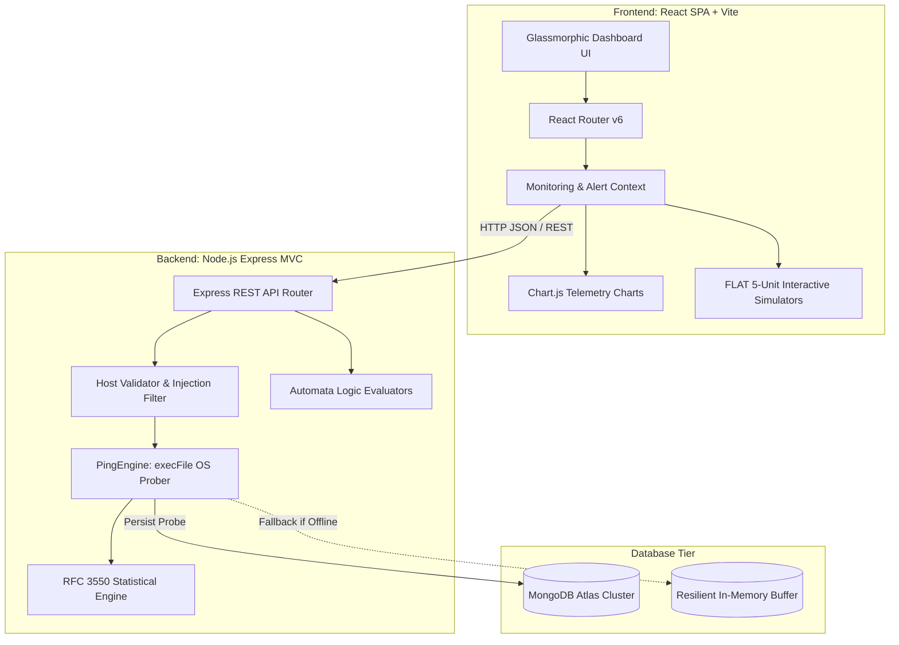

# NetPulse: Network Packet Loss & Latency Monitoring Dashboard

[](https://opensource.org/licenses/MIT)
[](https://nodejs.org/)
[](https://react.dev/)
[](https://expressjs.com/)
[](https://www.mongodb.com/atlas)

> **3rd Year B.Tech IT Academic Capstone Project**  
> Interdisciplinary integration of **Full Stack Web Development**, **Computer Networks**, and **Formal Languages & Automata Theory (FLAT)**.

---

## 📑 Table of Contents
1. [Project Overview](#project-overview)
2. [Academic Subjects Integration](#academic-subjects-integration)
3. [System Architecture](#system-architecture)
4. [Technology Stack](#technology-stack)
5. [Key Features](#key-features)
6. [API Documentation](#api-documentation)
7. [Installation & Setup](#installation--setup)
8. [Automated Testing](#automated-testing)
9. [Deployment Guide](#deployment-guide)
10. [Screenshots & UI Showcase](#screenshots--ui-showcase)

---

## 🌐 Project Overview

**NetPulse** is a responsive telemetry dashboard that captures real-time network health metrics (Round-Trip Time Latency, Packet Loss Percentage, RFC 3550 Inter-arrival Jitter, and Availability) using controlled ICMP echo probes. 

Beyond standard network monitoring, the application pioneers a novel educational bridge between **Computer Networks** and **Formal Languages and Automata Theory (FLAT)**, mapping real-time packet loss transitions, alert syntax derivations, and handshake protocol synchronization into formal automata models (DFA, NFA, RegEx, CFG, PDA, and Turing Machines).

---

## 🎓 Academic Subjects Integration

### 1. Full Stack Web Development
- **Frontend Architecture**: Modern Single Page Application (SPA) built with React 18, Vite, React Router v6, Chart.js, and glassmorphism styling.
- **Backend Architecture**: RESTful API structured under the Model-View-Controller (MVC) architectural pattern using Node.js and Express.
- **Database & Persistence**: Resilient dual-tier storage supporting **MongoDB Atlas** for persistent telemetry logging and an automated **In-Memory Buffer** for offline or zero-config execution.
- **Security & Reliability**: Strict input sanitization against command injection, rate-limiting (`express-rate-limit`), CORS security, and non-blocking process execution.

### 2. Computer Networks
- **ICMP Echo Telemetry**: Executes controlled Layer 3 ICMP echo request packets without invoking a system shell.
- **RFC 3550 Jitter Computation**: Calculates delay variance via the standard Exponentially Weighted Moving Average (EWMA) formula:  
  $$J(i) = J(i-1) + \frac{|D(i-1, i)| - J(i-1)}{16}$$
- **QoS & ITU-T G.114 Compliance**: Evaluates network performance against telecommunication standards ($\le 150\text{ ms}$ speech latency, $\le 1\%$ packet loss).
- **Educational Hub**: Interactive visual models for the **OSI 7-Layer Model**, **TCP/IP 4-Layer Architecture**, and **TCP Reno Congestion Control (AIMD)**.

### 3. Formal Languages & Automata Theory (FLAT)
- **Unit 1A (DFA)**: Deterministic Finite Automaton modeling network health states ($q_0 = \text{Normal}$, $q_1 = \text{Warning}$, $q_2 = \text{Critical}$) based on bitstreams where $0 = \text{Reply OK}$ and $1 = \text{Packet Drop}$.
- **Unit 1B (NFA)**: Non-Deterministic Finite Automaton detecting multi-drop burst anomalies for the formal language $L = (0+1)^* 11 (0+1)^*$.
- **Unit 2 (RegEx)**: Formal regular expression engine tokenizing IPv4 octets $[0-255]$ with Kleene's Theorem analysis.
- **Unit 3 (CFG & Parse Tree)**: Context-Free Grammar generating structured alert strings with dynamic Leftmost/Rightmost derivations and SVG Parse Trees.
- **Unit 4 (PDA)**: Pushdown Automata simulating balanced protocol handshakes ($a^n b^n$ where $a = \text{SYN/Push}$, $b = \text{ACK/Pop}$) with visual stack tracking and Instantaneous Descriptions (IDs).
- **Unit 5 (Turing Machine)**: 7-tuple Turing Machine computing even-parity packet integrity checks over infinite tape with halting analysis.

---

## 🏛 System Architecture



---

## 🛠 Technology Stack

| Domain | Technology | Purpose |
|---|---|---|
| **Frontend Framework** | React 18 + Vite | Component-driven UI with instant Hot Module Replacement (HMR) |
| **Routing** | React Router v6 | Client-side declarative routing and layout orchestration |
| **Data Visualization**| Chart.js + React-Chartjs-2 | High-performance interactive telemetry line, bar, and area charts |
| **Icons & Styling** | Lucide React + CSS3 | Scalable vector icons with responsive dark navy/cyan glassmorphism |
| **Backend Framework** | Node.js + Express.js | High-throughput REST API with MVC separation of concerns |
| **Process Execution** | Node `child_process.execFile` | Safe, shell-less ICMP process spawning preventing injection |
| **Database & ODM** | MongoDB Atlas + Mongoose | Cloud document persistence for historical telemetry and alerts |
| **DevOps & Bundling** | npm, Git, Concurrently | Monorepo orchestration and multi-environment build pipeline |

---

## 🚀 Key Features

1. **Overview Dashboard**: High-level telemetry gauges for Latency, Packet Loss %, Jitter, Availability, and Health Status.
2. **Live Monitoring Engine**: Real-time interval probing with animated radar pulse, streaming terminal log, and instant start/stop toggle.
3. **Performance Analytics**: Time-series Chart.js visualizers correlating latency spikes with packet drops and RFC 3550 delay variance.
4. **Historical Telemetry Log**: Paginated MongoDB records with search-by-target, status filtering, and **1-click RFC 4180 CSV export**.
5. **Configurable Alerting**: Threshold sliders for Latency (ms), Loss (%), and Jitter (ms) with active incident escalation badges.
6. **FLAT Interactive Lab**: Complete 5-unit interactive suite with live animated state diagrams, tape visualizers, and stack towers.
7. **Transparent Demo Mode**: Explicitly labeled simulation fallback for restricted cloud sandbox environments where raw ICMP sockets are blocked.

---

## 📡 API Documentation

### Ping & Telemetry
- `POST /api/ping/probe`  
  **Body**: `{ "target": "8.8.8.8", "count": 4, "timeoutMs": 3000, "isDemo": false }`  
  **Response**: `{ "success": true, "data": { "latencyMs": 24.5, "packetLossPercent": 0, "jitterMs": 1.2, "status": "ONLINE" } }`
- `GET /api/ping/overview`  
  Returns summary stats of latest probes, availability, and active targets.

### Analytics & History
- `GET /api/analytics?limit=50`  
  Returns min/max/avg metrics and time-series arrays formatted for Chart.js.
- `GET /api/history?page=1&limit=20&search=8.8.8.8&status=ONLINE`  
  Paginated historical query.
- `GET /api/history/export`  
  Downloads structured `.csv` report.
- `DELETE /api/history/clear`  
  Clears telemetry database records.

### FLAT Simulators
- `POST /api/flat/dfa` — `{ "input": "0010110" }`
- `POST /api/flat/nfa` — `{ "input": "010110" }`
- `POST /api/flat/regex` — `{ "ip": "192.168.1.1" }`
- `POST /api/flat/cfg` — `{ "level": "[CRITICAL]", "code": "ERR_LATENCY", "target": "8.8.8.8" }`
- `POST /api/flat/pda` — `{ "input": "aaabbb" }`
- `POST /api/flat/turing` — `{ "input": "101101" }`

---

## 💻 Installation & Setup (Windows PowerShell)

### Prerequisites
- Node.js v18.0.0 or higher
- Git for Windows

### Step 1: Clone or Navigate to Directory
```powershell
cd "C:\Users\VETRIVEL P R\.gemini\antigravity\scratch\network-monitoring-dashboard"
```

### Step 2: Install Dependencies
```powershell
# From project root:
npm run install:all
```

### Step 3: Configure Environment Variables
```powershell
# Server configuration
Copy-Item server/.env.example server/.env

# Client configuration
Copy-Item client/.env.example client/.env
```

### Step 4: Run Locally (One-Click Launch)
```powershell
# Launch both Frontend & Backend simultaneously:
./start-windows.ps1

# Or run via npm:
npm run dev
```

The frontend will be available at **`http://localhost:5173`** and the backend at **`http://localhost:5000`**.

---

## 🧪 Automated Testing

Run the automated test suite covering injection sanitization, jitter formulas, and all FLAT simulation engines:

```powershell
cd server
npm test
```

Expected output:
```
>>> RUNNING NETPULSE UNIT & ALGORITHM TEST SUITE <<<
✔ Test 1 Passed: Command injection vectors successfully blocked.
✔ Test 2 Passed: RFC 3550 Jitter correctly computed: 1.02 ms
✔ Test 3 Passed: DFA status transitions verified.
✔ Test 4 Passed: NFA consecutive drop detection verified.
✔ Test 5 Passed: IPv4 Regex validation passed.
✔ Test 6 Passed: CFG and Parse Tree generated.
✔ Test 7 Passed: PDA stack operations and handshake balancing verified.
✔ Test 8 Passed: Turing Machine tape, head transitions, and halting verified.
>>> ALL 8 TEST SUITES COMPLETED WITH 100% SUCCESS <<<
```

---

## ☁️ Deployment Guide

### 1. MongoDB Atlas Setup
1. Create a free cluster on [MongoDB Atlas](https://www.mongodb.com/atlas).
2. Create a database user and whitelist IP `0.0.0.0/0` (Allow Access from Anywhere).
3. Copy your connection string into `server/.env`:
   ```env
   MONGODB_URI=mongodb+srv://<username>:<password>@cluster0.mongodb.net/network_monitor?retryWrites=true&w=majority
   ```

### 2. Render Deployment (Backend API)
1. Link your repository to [Render](https://render.com/).
2. Create a **Web Service**:
   - **Root Directory**: `server`
   - **Build Command**: `npm install`
   - **Start Command**: `npm start`
3. Environment Variables:
   - `NODE_ENV`: `production`
   - `PORT`: `10000`
   - `CLIENT_URL`: `https://your-frontend.vercel.app`
   - `MONGODB_URI`: `<Your MongoDB Atlas URI>`
   - `DEMO_MODE`: `false` (or `true` if hosting provider disables raw ICMP sockets)

### 3. Vercel Deployment (Frontend React App)
1. Import repository to [Vercel](https://vercel.com/).
2. Select **Framework Preset**: `Vite`.
3. Set **Root Directory**: `client`.
4. Environment Variables:
   - `VITE_API_BASE_URL`: `https://your-backend.onrender.com/api`
5. Deploy! Single-Page Application routing is automatically handled via `client/vercel.json`.

---

## 📸 Screenshots & UI Showcase

- **Overview Dashboard**: Real-time KPI stat cards, ICMP ping on demand, recent probe table.
- **Live Probing Feed**: Visual radar pulses, streaming console logs, active connection status.
- **Performance Analytics**: Multi-series Chart.js timelines for latency, loss %, and jitter.
- **FLAT Learning Lab**: State machines for DFA/NFA, IPv4 token breakdown, SVG Parse Tree, LIFO PDA stack, and animated Turing Machine tape.